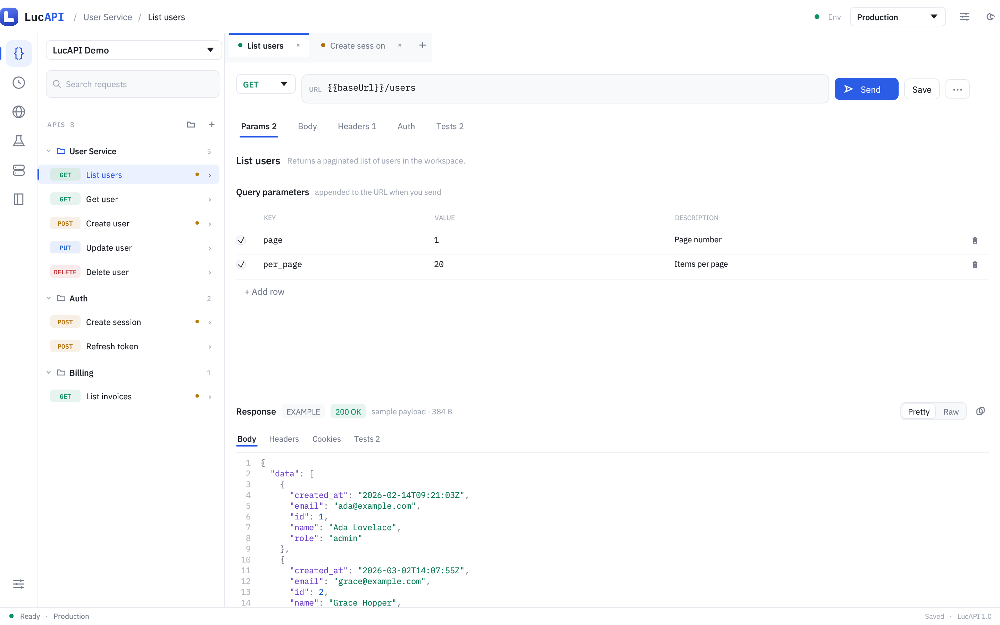

<p align="center">
  
</p>

<h1 align="center">LucAPI</h1>

<p align="center">
  <strong>Cliente de APIs de escritorio, local-first, escrito en Rust.</strong><br>
  Diseña, envía, prueba y documenta tus endpoints sin salir de tu máquina.
</p>

<p align="center">
  
  
  
  
  
  
</p>



---

## Qué es LucAPI

LucAPI es una aplicación nativa de escritorio para trabajar con APIs HTTP: un
cliente tipo Postman/Apidog pero **local-first**, sin cuenta, sin nube y sin
telemetría. Todas tus colecciones, entornos e historial viven en un único
archivo JSON en tu disco; nada sale de tu máquina salvo las peticiones que tú
decides enviar.

Se compila como un binario único de Rust con interfaz [egui](https://github.com/emilk/egui)
(renderizado inmediato, sin webview) y se empaqueta como `LucAPI.app` en macOS.

## Características

### Editor de peticiones

- Métodos **GET, POST, PUT, PATCH, DELETE, HEAD y OPTIONS**, con insignias de
  color por método.
- Barra de URL con autocompletado de `{{variables}}` y resaltado de variables
  sin definir.
- Pestañas de **Params**, **Body**, **Headers**, **Auth** y **Tests**, con filas
  que se activan/desactivan individualmente.
- Cuerpos en **JSON, texto, formulario (`x-www-form-urlencoded`), multipart con
  archivos y binario**.
- Editor con numeración de líneas, resaltado y ajuste de tamaño.

### Autenticación

- **Heredar de la colección** (auth a nivel de carpeta, que las peticiones
  pueden sobrescribir).
- Sin auth, **Bearer token**, **Basic auth**, **API key** (cabecera
  configurable).
- **OAuth2 client credentials** y **OAuth2 PKCE** con servidor de redirección
  local para capturar el `code` automáticamente.

### Colecciones y entornos

- Colecciones con carpetas anidadas, búsqueda de peticiones y creación rápida.
- **Entornos** con variables `{{nombre}}` y marcado de secretos, con selector
  de entorno activo siempre visible.
- Historial de envíos por petición.

### Respuesta

- Estado, tiempo total y **TTFB**, tamaño y cabeceras de respuesta.
- **Árbol JSON interactivo** con búsqueda, plegado y cientos de miles de nodos
  sin perder fluidez (filas de altura uniforme y virtualización).
- Vistas **Pretty / Raw**, copia al portapapeles y comparación de cabeceras.
- **Desglose de fases de red**: DNS, TCP y TLS medidos en paralelo al envío
  real, para saber si la lentitud es del servidor o de la conexión.
- Envíos **asíncronos**: puedes seguir editando mientras una petición vuela.

### Pruebas

- **Assertions** declarativas: código de estado, cuerpo contiene, campo JSON
  igual a, cabecera igual a y tiempo de respuesta por debajo de.
- **Captures**: extrae un campo JSON o una cabecera de la respuesta y guárdalo
  como variable de entorno secreta — el flujo *login → usar token* funciona
  encadenado.
- Pestaña **Tests** con la ejecución de toda la colección y resultados por
  request.

### Servidor de simulación (mock)

- Servidor HTTP local real que sirve las rutas de tu colección, útil para
  desarrollar el frontend antes de que exista el backend.
- **Latencia artificial** configurable y **fallos inyectables** (timeout o
  corte de conexión) para probar los caminos tristes del cliente.

### Importar y exportar

- Importa **cURL** pegado, **OpenAPI 3.x** y **colecciones de Postman**,
  detectando el formato automáticamente y avisando de lo que no se pudo mapear.
- Exporta a **OpenAPI 3** y **Postman**, listo para compartir con el equipo.

### Snippets de código

Genera el equivalente de la petición en **cURL, JavaScript (fetch), Python
(requests), Go, Rust (reqwest) y HTTPie**, con las variables ya resueltas.

### Documentación publicable

- Genera un **`index.html` autocontenido** (CSS y JS en línea, sin dependencias)
  a partir de tu colección: pensado para GitHub Pages o cualquier hosting
  estático.
- Enlaces compartibles por endpoint, tema claro u oscuro y toggles para
  ejemplos, cuerpos y resumen de auth.
- **Los secretos se redactan** antes de escribir nada: cabeceras y variables
  marcadas como secretas, tokens bearer, contraseñas Basic, API keys y secretos
  OAuth2 aparecen como `••••`.

### Secretos en el Llavero de macOS

- Con **Settings → Secrets → Keep secrets in the macOS Keychain**, el workspace
  guarda solo una referencia `keychain://…` y el valor real vive en tu Llavero.
- El archivo JSON se puede versionar o compartir sin filtrar credenciales.
- Auditoría desde la línea de comandos (`lucapi secrets --audit`) que falla si
  queda algún secreto en texto plano, ideal como guardia de pre-commit o CI.

### Calidad de vida

- **Deshacer/rehacer** por instantáneas (cubre renombrados, borrados e
  importaciones), autoguardado y **restauración de la sesión** (pestañas
  abiertas al reabrir).
- Tema **claro y oscuro**, tipografías IBM Plex Sans y Plex Mono, menú nativo de
  macOS.
- Apertura desde el navegador: `lucapi https://api.ejemplo.com/users` abre la
  app con esa URL ya cargada.
- Atajos de teclado:

| Atajo | Acción |
|-------|--------|
| `⌘ ⏎` | Enviar petición |
| `⌘ S` | Guardar workspace |
| `⌘ N` | Nueva petición |
| `⌘ W` | Cerrar pestaña |
| `⇧ ⌘ C` | Copiar como cURL |
| `⇧ ⌘ I` | Importar desde cURL |
| `⌘ Z` / `⇧ ⌘ Z` | Deshacer / rehacer |

## Instalación

Requisitos: **Rust 1.85+** (edición 2024) y macOS 11 o superior para el paquete
`.app`. LucAPI se desarrolla y se prueba en macOS: el menú nativo y el
almacenamiento en el Llavero son propios de esa plataforma, mientras que el resto
del cliente es independiente del sistema.

```bash
git clone https://github.com/roperto84/lucapi.git
cd lucapi

# Desarrollo
cargo run

# Pruebas
cargo test

# Binario optimizado
cargo build --release
./target/release/lucapi
```

### Paquete `.app`

```bash
./scripts/bundle.sh            # genera dist/LucAPI.app
./scripts/bundle.sh --install  # y lo copia a /Applications
```

El script compila en release, monta el bundle, copia el icono y firma ad-hoc para
que Gatekeeper no se queje de una app compilada localmente.

## Uso de la línea de comandos

El mismo binario tiene tres subcomandos pensados para automatizar:

### `lucapi run` — ejecutar colecciones en CI

```bash
lucapi run \
  --workspace ./api/workspace.json \
  --env Production \
  --format junit --output report.xml
```

Ejecuta las peticiones sin abrir la ventana y termina con un código de salida
útil: `0` todo bien, `1` algún fallo, `2` uso inválido o workspace ilegible.
Soporta `--folder`, `--only`, `--var clave=valor`, `--timeout`, `--fail-fast`,
`--list` y reportes en `text`, `json` o **JUnit XML**. Detalles en
[docs/ci.md](docs/ci.md).

### `lucapi docs` — publicar documentación

```bash
lucapi docs --output ./site --title "Acme API" --base-url https://docs.acme.dev
```

Escribe un `index.html` autocontenido y redacta los secretos. Detalles en
[docs/publish.md](docs/publish.md).

### `lucapi secrets` — auditar credenciales

```bash
lucapi secrets --audit --workspace ./api/workspace.json
lucapi secrets --check   # valida que el Llavero funcione
```

Detalles en [docs/secrets.md](docs/secrets.md).

## Dónde viven tus datos

| Qué | Dónde |
|-----|-------|
| Workspace (colecciones, entornos, ajustes) | `~/.lucapi/workspace.json` o `$LUCAPI_WORKSPACE` |
| Secretos (opcional) | Llavero de macOS, referenciados como `keychain://…` |
| Nada más | No hay cuenta, ni servidor, ni telemetría |

El guardado es atómico (escritura a `.tmp` y renombrado) y el archivo es JSON
legible, así que puedes versionarlo junto a tu proyecto y revisar los diffs.

## Estructura del proyecto

```
src/
├── main.rs        Arranque, parseo de argumentos y ventana
├── app.rs         Estado de la app, vistas y composición de la UI
├── model.rs       Modelo de datos, workspace de demo y persistencia
├── theme.rs       Paleta, tipografías y estilo de egui
├── widgets.rs     Widgets pintados: iconos, insignias, tablas, JSON
├── http.rs        Ejecución HTTP, assertions y servidor mock
├── runner.rs      Runner headless para CI y subcomandos de CLI
├── codegen.rs     Importación de cURL y generación de snippets
├── importer.rs    Importación de OpenAPI 3.x y Postman
├── exporter.rs    Exportación a OpenAPI 3 y Postman
├── docs.rs        Generador del sitio de documentación
├── json_tree.rs   Árbol JSON virtualizado de la respuesta
├── vars.rs        Escaneo de `{{variables}}` y autocompletado
├── vault.rs       Secretos en el Llavero de macOS
├── oauth.rs       PKCE y listener de redirección local
├── timing.rs      Sonda de fases DNS/TCP/TLS
├── history.rs     Deshacer/rehacer por instantáneas
└── menu.rs        Menú nativo de macOS (muda)
```

## Pruebas

```bash
cargo test
```

**83 tests** unitarios cubren las piezas que no son píxeles: generación de
snippets y parseo de cURL, importación de OpenAPI/Postman, evaluadores de
assertions y captures, servidor mock (incluida la inyección de fallos), reportes
JUnit/JSON, redacción de secretos en la documentación, persistencia atómica,
historial de undo, árbol JSON y el listener OAuth. Las pruebas de Llavero usan un
backend en memoria para no tocar el real.

## Stack

- **[eframe](https://crates.io/crates/eframe) / [egui](https://crates.io/crates/egui) 0.31** — UI inmediata en GPU.
- **[reqwest](https://crates.io/crates/reqwest)** con **rustls** — HTTP/2, gzip y brotli, sin depender de OpenSSL.
- **[tokio](https://crates.io/crates/tokio)** — envíos asíncronos y servidor mock.
- **serde / serde_json / serde_yaml** — persistencia y (de)serialización de especificaciones.
- **[muda](https://crates.io/crates/muda)** — menú nativo; **[rfd](https://crates.io/crates/rfd)** — diálogos del sistema; **[arboard](https://crates.io/crates/arboard)** — portapapeles.
- Tipografías **IBM Plex** (SIL Open Font License, ver `assets/fonts/OFL-IBMPlex.txt`).

## Estado y alcance

LucAPI cubre el flujo diario completo de trabajo con APIs: crear, enviar,
inspeccionar, probar, simular, importar, exportar y documentar. Es una
reimplementación independiente inspirada en la experiencia de herramientas como
Apidog, centrada en el escritorio y en no depender de un servicio en la nube.

Fuera de alcance por ahora: sincronización en equipo y colaboración en tiempo
real, editor de esquemas OpenAPI dentro de la app y clientes gRPC/WebSocket.

## Licencia

[MIT](LICENSE) © 2026 roperto84. Puedes usar, modificar, distribuir y vender el
software, siempre que conserves el aviso de copyright y la licencia.

---

Hecho con Rust 🦀 y bastante café.
